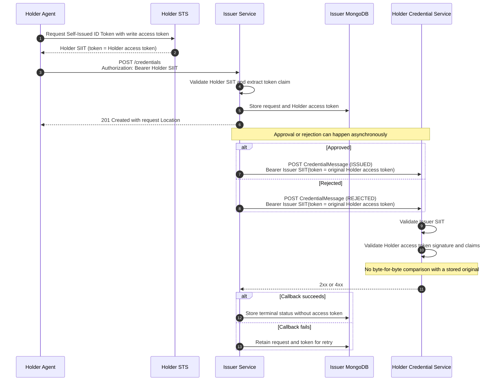

# D-TEC-015 — Authenticate credential callbacks and forward the Holder access token

## Metadata
- Status: Accepted
- Date: 2026-11-24
- Owner: TRUE Connector team
- Reviewers: —
- Confidence: Medium
- Supersedes: —
- Superseded by: —
- Tags: dcp, credential-issuance, access-token, security, jwt
- Risk Level: High
- Retroactively documented: The implementation predates this ADR.

## Context

DCP credential issuance has two different authorization facts to convey to the Holder's Credential Service:

- The callback must identify the Issuer that is sending a `CredentialMessage`.
- The Holder's original access token grants the Issuer write access to that Holder's Credential Service.

DCP v1.0.1's [Credential Issuance Protocol — Issuance Flow](https://eclipse-dataspace-dcp.github.io/decentralized-claims-protocol/v1.0.1/#issuance-flow) describes the client sending a Self-Issued ID Token that may contain an access token, and the Issuer later sending its own Self-Issued ID Token with that access token in the `token` claim. The Credential Service validates both. The specification labels that flow non-normative. Separately, the normative [Credential Request API](https://eclipse-dataspace-dcp.github.io/decentralized-claims-protocol/v1.0.1/#credential-request-api) says that an access token in the request's `token` claim MUST be used by the Issuer, and the [Credential Service access-token requirements](https://eclipse-dataspace-dcp.github.io/decentralized-claims-protocol/v1.0.1/#submitting-an-access-token) require access tokens to be carried in a Self-Issued ID Token submitted as a Bearer token when access control is supported.

The request is asynchronous, so the Issuer must retain the access token between receiving the request and sending the callback. In this implementation, the Holder does not persist the token it sent or compare it byte-for-byte with the callback token; it validates the nested token's signature and claims, including that it is the Holder's token and is addressed to the authenticated Issuer.

## Decision

For credential callbacks, the Issuer sends a newly signed Self-Issued ID Token in the HTTP `Authorization` header. The outer token identifies the Issuer and is addressed to the Holder; its `token` claim contains the exact Holder-issued access token extracted from the original request. The Holder validates the outer Issuer token and then validates the nested Holder access token before processing either an `ISSUED` or `REJECTED` `CredentialMessage`.

The Issuer stores the received access token on its internal `CredentialRequest` record, excludes it from Jackson JSON serialization, and removes it from the stored record after a successful terminal callback. If callback delivery fails, the token remains on the request for retry. The Holder validates the nested token cryptographically and by claims; it does not compare the token string with a saved original.

The same callback authentication is used for rejection notifications. DCP defines `REJECTED` as a `CredentialMessage` status, but its v1.0.1 issuance-flow callback text describes the asynchronous delivery in the approval case; applying the callback authentication to rejections is this implementation's security policy.

### Implemented flow

The authentication tokens are sent in the HTTP header, not in the `CredentialMessage` JSON body.

## Alternatives Considered

- **Send only the Holder access token as the callback Bearer token** → rejected because it authenticates a Holder-issued grant, not the Issuer sending the callback. The Holder could not authenticate the callback's Issuer identity from that token alone, and the Holder endpoint currently requires an Issuer Self-Issued ID Token.
- **Send only an Issuer Self-Issued ID Token** → rejected because it authenticates the Issuer but omits the Holder's per-request write authorization.
- **Send the tokens in separate headers** → rejected because it still requires both tokens, adds a non-standard header contract, and does not simplify the two independent checks. The DCP access-token pattern already carries the access token in a Self-Issued ID Token.

## Rationale

The outer and inner tokens answer different questions: “which Issuer sent this callback?” and “did the Holder authorize this Issuer to write to its Credential Service?” Sending the original Holder token alone cannot establish the callback sender's identity; sending only the Issuer token cannot prove the Holder's write grant. Wrapping the original access token in the Issuer's Self-Issued ID Token carries both proofs in the single Bearer header described by the DCP v1.0.1 issuance flow.

Persisting the original token supports the asynchronous callback without exposing it through the request's JSON representation. Retaining it after failed delivery preserves the data needed for a retry. The Holder's validation of the signed token and its audience establishes that it is a valid Holder-issued grant for the Issuer; the Holder does not need to retain the original token string for equality comparison.

## Consequences

### Positive
- The callback authenticates the Issuer and carries the Holder's write authorization in one Bearer header.
- The `CredentialMessage` body remains independent of authentication material.
- A failed callback retains the authorization value needed to attempt delivery again.

### Negative
- The Issuer retains a bearer access token in MongoDB while the request is pending.
- `@JsonIgnore` prevents JSON serialization but does not encrypt the token at rest; the DCP model has no field-encryption annotation.
- The access token currently expires after five minutes, while DCP issuance callbacks may be asynchronous. A later callback can therefore be rejected by the Holder, and retrying the same expired token does not resolve that failure.
- The Holder validates the nested token's signature and claims but does not verify byte-for-byte equality with the token originally sent.

### Risks
- **Database disclosure exposes pending Holder access tokens.** Restrict database access and use deployment-level MongoDB encryption at rest where configured. The DCP module currently provides no at-rest encryption for this field.
- **Delayed approval can outlive the access token.** The current flow has no refresh or renewal mechanism; an approval delivered after expiry can fail. A follow-up decision is needed if approval latency can exceed the five-minute token lifetime.
- **The specification's detailed wrapping instructions are in a flow labelled non-normative.** The normative request and Credential Service access-token requirements support use of the token, but the Issuer-SIIT wrapping is specifically described in the v1.0.1 flow. Keep this distinction explicit when describing conformance.

## Related
- Decisions: —
- Docs: [DCP specification gap inventory](../DCP_SPEC_GAPS.md), [credential message examples](../credential_message_examples.md)
- Implementation: [`CredentialRequest`](../../dcp-common/src/main/java/it/eng/dcp/common/model/CredentialRequest.java), [`IssuerService`](../../dcp-issuer/src/main/java/it/eng/dcp/issuer/service/IssuerService.java), [`CredentialDeliveryService`](../../dcp-issuer/src/main/java/it/eng/dcp/issuer/service/CredentialDeliveryService.java), [`HolderService`](../../dcp-holder/src/main/java/it/eng/dcp/holder/service/HolderService.java)
- Tickets: #408
