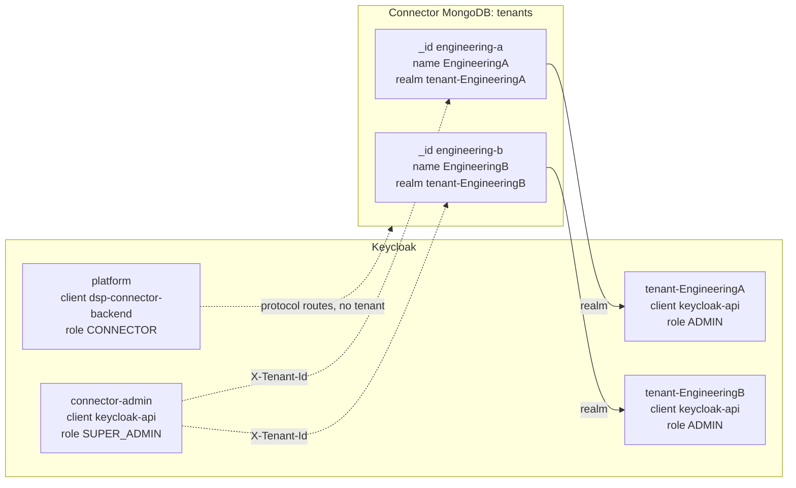
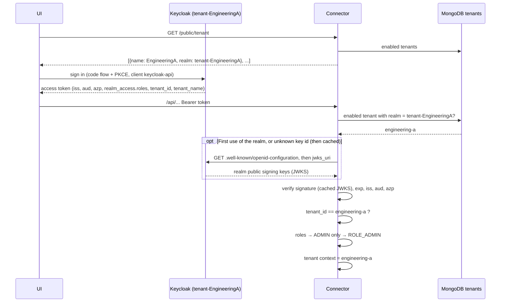

# How tenants and users map to Keycloak realms

This page explains how the connector's tenants and users map to Keycloak realms in `KEYCLOAK` mode: which realm each kind of account lives in, which token claims link a user to a tenant, and what the connector checks on each request.

- For the full validation rules and every 401/403 case, see [security.md](security.md#keycloak-authentication-mode-keycloak).
- For creating realms and users with the scripts, see [keycloak-scripts.md](keycloak-scripts.md).

## The short version

- **One realm per tenant.** Every tenant has its own Keycloak realm, named in the tenant's `realm` field (e.g. `tenant-EngineeringA`).
- **Two shared realms.** Super-admins live in `connector-admin`. Connector-to-connector (machine-to-machine) traffic uses `platform`.
- **The realm decides who you are; the tenant record decides whether that realm is trusted.** A tenant realm is trusted only while an **enabled** tenant in MongoDB names it.
- **The `tenant_id` claim must equal the tenant `_id`** (e.g. `engineering-a`). It is not the realm name and not the tenant `name`.
- **Each realm may grant exactly one connector role:** tenant realm → `ADMIN`, `connector-admin` → `SUPER_ADMIN`, `platform` → `CONNECTOR`.

## The three kinds of realm

| Realm | Configured by | Who signs in | Client | Realm role (connector authority) | `tenant_id` claim | Routes |
|---|---|---|---|---|---|---|
| Tenant realm, e.g. `tenant-EngineeringA` | The tenant's `realm` field in MongoDB | Tenant administrators, through the UI | `keycloak-api` (public, PKCE) | `ADMIN` (`ROLE_ADMIN`) | Required, equal to the tenant `_id` | `/api/**`, limited to that tenant |
| `connector-admin` | `application.keycloak.admin-realm` | Super-admins, through the UI | `keycloak-api` | `SUPER_ADMIN` (`ROLE_SUPER_ADMIN`) | Must be absent | `/api/**`, all tenants, or one tenant through `X-Tenant-Id` |
| `platform` | `application.keycloak.platform-realm` | Other connectors (client credentials grant) | `dsp-connector-backend` (confidential) | `CONNECTOR` (`ROLE_CONNECTOR`) | Must be absent | Protocol routes only (`/connector/**`, `/catalog/**`, `/negotiations/**`, `/transfers/**`) |

The realm *names* `platform` and `connector-admin` are configurable. Tenant realm names are free (the `tenant-` prefix is only a convention), but a tenant realm may never be `master`, the platform realm or the admin realm.

## Tenant ↔ realm: the link from the connector side

A tenant is a document in the `tenants` collection. Three of its fields matter for Keycloak:

| Tenant field | Example | Role in the mapping |
|---|---|---|
| `_id` | `engineering-a` | The tenant identifier. Tenant users carry it in the `tenant_id` claim. |
| `realm` | `tenant-EngineeringA` | The Keycloak realm whose tokens this tenant accepts. The connector trusts `<application.keycloak.base-url>/realms/<realm>`. |
| `enabled` | `true` | Only enabled tenants make their realm trusted. |

The `name` field (e.g. `EngineeringA`) is display data. The UI shows it, and the tenant realm repeats it in the `tenant_name` claim (see below), but the connector never uses it for access decisions.

How the link behaves:

- **It is one-to-one.** Two tenants can never share a realm, whether enabled or disabled; that is a 409 on create or update. A realm without a tenant is simply not trusted.
- **It is evaluated on every request.** Creating, disabling, deleting or re-pointing a tenant takes effect on the next request, without a restart. Only the realm's signing keys are cached.
- **`realm: null` is allowed.** That tenant then accepts no Keycloak tokens. A super-admin can still work on it with `X-Tenant-Id`.
- **The UI finds the realm through the connector.** `GET /public/tenant` (no authentication) returns the name and realm of every enabled tenant. The UI lets the person pick a tenant, then signs in to that tenant's realm. Super-admins sign in to `connector-admin`.

## User ↔ tenant: the link from the Keycloak side

The connector has no user store in `KEYCLOAK` mode. A tenant "has" a user only because of what is in that user's token, and the token content is set up in the tenant realm:

| Keycloak setting | Token claim | Example | Used by the connector for |
|---|---|---|---|
| User attribute `tenant_id`, mapped by the realm-default `org` scope | `tenant_id` | `engineering-a` | **Tenant binding.** It must equal the `_id` of the tenant that owns the token's realm, otherwise 401. It also becomes the tenant context of the request. |
| Realm role `ADMIN`, plus a scope mapping on `keycloak-api` | `realm_access.roles` | `["ADMIN"]` | **Authority.** It becomes `ROLE_ADMIN`. All other roles are dropped. |
| `connector-audience` scope (audience mapper) | `aud` | `dsp-true-connector` | **Audience check.** Without it, 401. |
| Client the user signed in with | `azp` | `keycloak-api` | **Client check.** Must equal `application.keycloak.ui-client-id`. |
| Realm `frontendUrl` / `KC_HOSTNAME` | `iss` | `http://localhost:8180/realms/tenant-EngineeringA` | **Selects the realm,** and through it the tenant. Must match `base-url`. |
| Hard-coded mapper in the `org` scope | `tenant_name` | `EngineeringA` | Shown by the UI (the same claim `INTERNAL` mode puts in its tokens). Must equal the tenant `name`; `InitialDataSeedConsistencyTest` checks this for the seeds. |

The seed realms also emit claims that the connector does **not** read. They are kept for compatibility with the provisioning scripts and for future use:

- `org`, hard-coded per realm (e.g. `EngineeringA`, `acme`). The tenant is never derived from `org`.
- the user attribute `org_type` (e.g. `operator`, `tech`)
- `accessible_tenants` and `home_realm`, emitted only when the user has those attributes

Keycloak drops `tenant_id`, `org_type` and other undeclared attributes from regular users unless the realm's user profile allows them. The seed tenant realms therefore use the unmanaged-attribute policy `ADMIN_EDIT`.

### Three different identifiers for one tenant

They look alike, which makes them easy to mix up:

| Identifier | Example | Where it lives |
|---|---|---|
| Tenant `_id` | `engineering-a` | MongoDB `_id`, the `tenant_id` claim, the `X-Tenant-Id` header, URLs |
| Realm name | `tenant-EngineeringA` | MongoDB `realm`, Keycloak, the `iss` claim |
| Tenant name | `EngineeringA` | MongoDB `name`, the `tenant_name` claim, the UI |

Putting the realm name or the tenant name into `tenant_id` is the most common mistake, and it gives 401.

## What happens to a request

For a tenant user on `/api/**`:

In order:

1. **Select the issuer.** The unverified `iss` is used only to look up a trusted issuer. That is either one of the two static realms, or `<base-url>/realms/<realm>` where an enabled tenant holds that `realm`. An unknown issuer gets 401 with no network call.
2. **Verify the token.** The connector checks the signature itself against that realm's public keys, then `exp`, `nbf` and the exact `iss`. Keycloak is not asked whether the token is valid. The connector downloads the keys on the first use of a realm (discovery document, then `jwks_uri`) and caches them; an unknown key id (`kid`) triggers a new download, so key rotation needs no restart.
3. **Apply the realm's rules.**
   - A tenant realm needs `aud`, `azp = keycloak-api`, and `tenant_id` equal to the owning tenant's `_id`.
   - `connector-admin` needs the same `aud` and `azp`, and must not have `tenant_id`.
   - `platform` needs `aud`, `azp = dsp-connector-backend` and the `CONNECTOR` role, and must not have `tenant_id`.
4. **Map the role.** Only the realm's own role counts (`ADMIN`, `SUPER_ADMIN` or `CONNECTOR`). If a token carries another realm's privileged role, for example `SUPER_ADMIN` from a tenant realm, the whole token is rejected with 401 and a `SECURITY_REALM_ROLE_VIOLATION` audit event.
5. **Set the tenant context.**
   - A tenant user is fixed to their own `tenant_id`.
   - A super-admin has no tenant and sees all tenants. They can act for one enabled tenant by sending `X-Tenant-Id: <tenant _id>`, which publishes a `TENANT_DELEGATION` audit event. Anyone else who sends the header gets 403.

Because the tenant comes from the realm and not from the token, a user of `tenant-EngineeringA` cannot reach `engineering-b`. Even a token with `tenant_id=engineering-b` fails at step 3.

## The seeded mapping

The repository seeds both sides. The realms are in `ci/docker/keycloak_resources/`; the tenants are in the `initial_data*.json` files.

| Tenant `_id` | Tenant `name` | Realm | Users (password) | Seeded in |
|---|---|---|---|---|
| `engineering-a` | `EngineeringA` | `tenant-EngineeringA` | `admin` (`password`) | connector A and every single-connector seed |
| `engineering-b` | `EngineeringB` | `tenant-EngineeringB` | `adminB` (`password`) | connector B |
| `acme` | `Acme` | `tenant-acme` | `coyote` (`coyote`), `roadrunner` (`roadrunner`) | `connector/src/main/resources/initial_data.json` only (demo) |
| none | none | `connector-admin` | `superadmin@mail.com` (`password`), `SUPER_ADMIN` | all |
| none | none | `platform` | service account of `dsp-connector-backend`, `CONNECTOR` | all |

`InitialDataSeedConsistencyTest` checks that each seeded tenant's `realm` is a seeded realm, that the realm's users carry that tenant's `_id` in `tenant_id`, and that the realm's `tenant_name` equals the tenant `name`.

All connectors share the one `platform` realm. Connector A's tenant `engineering-a` and connector B's tenant `engineering-b` each trust their own tenant realm, and both accept and send `platform` tokens for protocol calls.

## Adding a tenant: both halves

| Step | Side | How |
|---|---|---|
| 1. Create the realm | Keycloak | `scripts/keycloak/create-tenant-realm.sh Logistics "Logistics tenant"` creates realm `tenant-Logistics` with `ADMIN`, `keycloak-api` and the scopes. |
| 2. Create the tenant | Connector | As super-admin, `POST /api/v1/tenants` with `{"id": "logistics", "name": "Logistics", "realm": "tenant-Logistics", "enabled": true, ...}` (see [multi-tenant-user-guide.md](multi-tenant-user-guide.md#create-a-tenant)). |
| 3. Create users | Keycloak | `scripts/keycloak/create-user.sh tenant-Logistics alice alice@example.com '<pw>' ADMIN --tenant-id logistics` |

Order does not matter, but the realm is trusted only once both steps 1 and 2 are done. To lock a tenant out of the admin API, disable the tenant: its realm stops being trusted on the next request, whatever happens in Keycloak.

## Common mistakes

| Mistake | Result |
|---|---|
| `tenant_id` set to the realm name or the tenant name | 401 (tenant binding) |
| `tenant_id` attribute set, but the realm has no `ADMIN_EDIT` policy | The attribute is dropped, the claim is missing, 401 |
| Tenant realm created, but no enabled tenant names it | 401 (unknown issuer) |
| User created with role `ADMIN` in `connector-admin`, or `SUPER_ADMIN` in a tenant realm | 401 plus `SECURITY_REALM_ROLE_VIOLATION` |
| Super-admin with a `tenant_id` attribute | 401 |
| `keycloak-api` without the `connector-audience` scope | No `aud`, 401 |
| `ADMIN` role assigned but no scope mapping on `keycloak-api` (`fullScopeAllowed=false`) | The role is missing from the token, 403 |
| Realm `frontendUrl` / `KC_HOSTNAME` differs from `application.keycloak.base-url` | `iss` mismatch, every token gets 401 |
| `tenant_name` mapper value differs from the tenant `name` | Access works, but the UI shows a different name than `INTERNAL` mode would |
